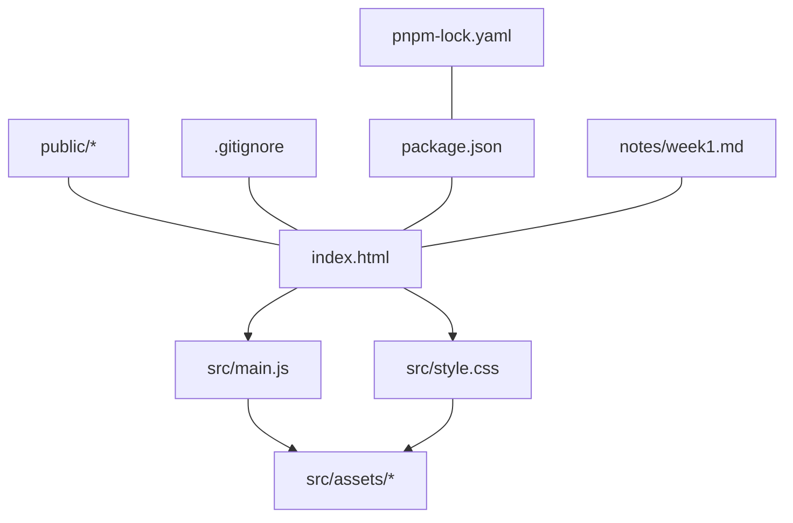
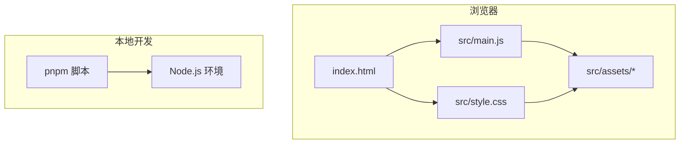
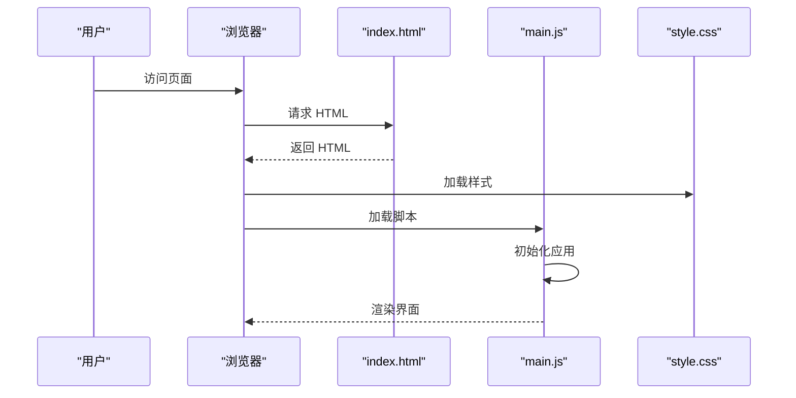
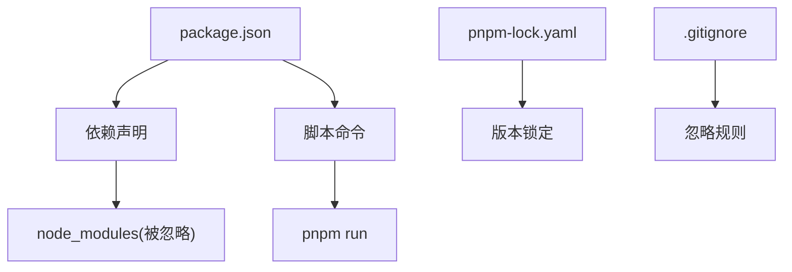

# 开发指南

<cite>
**本文引用的文件**   
- [README.md](file://README.md)
- [package.json](file://package.json)
- [.gitignore](file://.gitignore)
- [index.html](file://index.html)
- [src/main.js](file://src/main.js)
- [src/style.css](file://src/style.css)
- [notes/week1.md](file://notes/week1.md)
</cite>

## 目录
1. [简介](#简介)
2. [项目结构](#项目结构)
3. [核心组件](#核心组件)
4. [架构总览](#架构总览)
5. [详细组件分析](#详细组件分析)
6. [依赖分析](#依赖分析)
7. [性能考虑](#性能考虑)
8. [故障排查指南](#故障排查指南)
9. [结论](#结论)
10. [附录](#附录)

## 简介
本指南面向 ol-week1 项目的开发者，提供从环境搭建、包管理（pnpm）、代码规范、调试与优化到 Git 版本控制的最佳实践。文档基于仓库现有结构与配置进行说明，帮助不同经验水平的开发者快速上手并高效协作。

## 项目结构
项目采用简洁的前端工程结构：入口 HTML、应用脚本与样式分离，资源与静态文件分目录存放，便于维护与扩展。

图表来源
- [index.html:1-200](file://index.html#L1-L200)
- [src/main.js:1-200](file://src/main.js#L1-L200)
- [src/style.css:1-200](file://src/style.css#L1-L200)
- [.gitignore:1-200](file://.gitignore#L1-L200)
- [package.json:1-200](file://package.json#L1-L200)

章节来源
- [index.html:1-200](file://index.html#L1-L200)
- [src/main.js:1-200](file://src/main.js#L1-L200)
- [src/style.css:1-200](file://src/style.css#L1-L200)
- [.gitignore:1-200](file://.gitignore#L1-L200)
- [package.json:1-200](file://package.json#L1-L200)

## 核心组件
- index.html：页面骨架与资源引入点，负责挂载应用入口脚本与样式。
- src/main.js：应用主逻辑入口，初始化模块、注册事件或渲染内容。
- src/style.css：全局样式与主题基础，建议按模块拆分至子样式文件。
- public：静态资源目录，存放不经过构建处理的资源（如图片、字体等）。
- notes/week1.md：本周学习与任务记录，便于团队同步进度与知识沉淀。

章节来源
- [README.md:1-200](file://README.md#L1-L200)
- [src/main.js:1-200](file://src/main.js#L1-L200)
- [src/style.css:1-200](file://src/style.css#L1-L200)
- [notes/week1.md:1-200](file://notes/week1.md#L1-L200)

## 架构总览
本项目为轻量前端应用，遵循“HTML 入口 + JS 主逻辑 + CSS 样式”的清晰分层。通过 pnpm 管理依赖与脚本命令，确保一致的开发体验与可复现的构建结果。

图表来源
- [index.html:1-200](file://index.html#L1-L200)
- [src/main.js:1-200](file://src/main.js#L1-L200)
- [src/style.css:1-200](file://src/style.css#L1-L200)
- [package.json:1-200](file://package.json#L1-L200)

## 详细组件分析

### 入口与加载流程
- index.html 作为页面入口，引入 main.js 与 style.css，并在 DOM 就绪后执行应用初始化。
- main.js 负责模块导入、事件绑定与视图渲染；style.css 定义全局样式与主题变量。

图表来源
- [index.html:1-200](file://index.html#L1-L200)
- [src/main.js:1-200](file://src/main.js#L1-L200)
- [src/style.css:1-200](file://src/style.css#L1-L200)

章节来源
- [index.html:1-200](file://index.html#L1-L200)
- [src/main.js:1-200](file://src/main.js#L1-L200)
- [src/style.css:1-200](file://src/style.css#L1-L200)

### 样式组织与模块化
- 建议将样式按功能模块拆分为独立文件（例如 components、pages），在 main.js 中按需引入或通过构建工具聚合。
- 使用 CSS 变量统一管理主题色、字号与间距，提升一致性。

章节来源
- [src/style.css:1-200](file://src/style.css#L1-L200)

### 资源管理与路径约定
- 静态资源统一放入 public 或 src/assets，避免硬编码路径。
- 图片、字体等资源建议使用相对路径或构建工具提供的别名。

章节来源
- [index.html:1-200](file://index.html#L1-L200)
- [src/main.js:1-200](file://src/main.js#L1-L200)

## 依赖分析
- package.json 定义项目元数据、脚本命令与依赖项。
- pnpm-lock.yaml 锁定依赖版本，保证团队与环境一致性。
- .gitignore 排除构建产物、依赖目录与 IDE 配置，减少仓库噪声。

图表来源
- [package.json:1-200](file://package.json#L1-L200)
- [pnpm-lock.yaml:1-200](file://pnpm-lock.yaml#L1-L200)
- [.gitignore:1-200](file://.gitignore#L1-L200)

章节来源
- [package.json:1-200](file://package.json#L1-L200)
- [pnpm-lock.yaml:1-200](file://pnpm-lock.yaml#L1-L200)
- [.gitignore:1-200](file://.gitignore#L1-L200)

## 性能考虑
- 首屏优化：最小化初始脚本体积，延迟加载非关键资源，合理使用懒加载与路由分割。
- 样式优化：合并与压缩 CSS，移除未使用样式，优先使用 CSS 变量与复用类名。
- 资源优化：图片压缩与格式选择（WebP/AVIF），字体子集化，CDN 缓存策略。
- 运行时优化：避免频繁重排重绘，使用事件委托，减少不必要的状态更新。

[本节为通用指导，无需特定文件引用]

## 故障排查指南
- 常见问题定位：
  - 页面空白：检查 index.html 是否正确引入 main.js 与 style.css，控制台是否有报错。
  - 样式失效：确认 CSS 路径与优先级，避免被覆盖或未加载。
  - 资源 404：核对 public 与 assets 路径，确保资源存在且未被忽略。
- 调试技巧：
  - 使用浏览器开发者工具的 Sources 面板断点调试 main.js。
  - 使用 Network 面板查看资源加载顺序与耗时。
  - 使用 Console 输出关键日志，结合条件判断缩小问题范围。
- 日志与错误处理：
  - 在关键分支添加 try/catch 捕获异常，记录上下文信息。
  - 对异步操作增加失败重试与超时处理，提升鲁棒性。

章节来源
- [src/main.js:1-200](file://src/main.js#L1-L200)
- [src/style.css:1-200](file://src/style.css#L1-L200)
- [index.html:1-200](file://index.html#L1-L200)

## 结论
ol-week1 项目结构清晰、职责分明，适合快速迭代与团队协作。遵循本指南中的包管理、代码规范、调试与优化实践，可显著提升开发效率与代码质量。建议持续完善样式模块化与资源管理策略，逐步引入构建工具以提升自动化水平。

[本节为总结性内容，无需特定文件引用]

## 附录

### 开发工作流程
- 环境准备：安装 Node.js 与 pnpm。
- 依赖安装：在项目根目录执行 pnpm install。
- 启动开发：根据 package.json 中的脚本命令运行开发服务器。
- 提交代码：遵循 Git 工作流，编写清晰的提交信息。

章节来源
- [package.json:1-200](file://package.json#L1-L200)

### 包管理（pnpm）最佳实践
- 使用 pnpm 替代 npm/yarn，获得更快的安装速度与更严格的依赖隔离。
- 固定依赖版本：提交 pnpm-lock.yaml 确保一致性。
- 脚本命名：保持语义化，如 dev、build、lint、test。
- 私有仓库：如需内部包，配置 pnpm 源与认证。

章节来源
- [package.json:1-200](file://package.json#L1-L200)
- [pnpm-lock.yaml:1-200](file://pnpm-lock.yaml#L1-L200)

### 代码规范与命名约定
- 文件命名：小写英文，使用连字符分隔（如 user-list.js）。
- 变量与函数：驼峰命名（camelCase），常量全大写加下划线（UPPER_SNAKE_CASE）。
- 组件与模块：按功能划分目录，每个模块单一职责。
- 注释风格：JSDoc 描述函数参数与返回值，复杂逻辑补充行内注释。

[本节为通用规范，无需特定文件引用]

### 文件组织规范
- src：源代码目录，包含 main.js、style.css 与 assets。
- public：静态资源，不经过构建处理。
- notes：学习与实践记录，便于知识沉淀。
- 根目录：配置文件与说明文档（package.json、.gitignore、README.md）。

章节来源
- [src/main.js:1-200](file://src/main.js#L1-L200)
- [src/style.css:1-200](file://src/style.css#L1-L200)
- [notes/week1.md:1-200](file://notes/week1.md#L1-L200)
- [.gitignore:1-200](file://.gitignore#L1-L200)
- [package.json:1-200](file://package.json#L1-L200)

### Git 版本控制最佳实践
- 分支策略：main 稳定分支，feature/xxx 功能分支，hotfix/xxx 修复分支。
- 提交信息：动词开头，简明扼要，必要时附加影响范围。
- 忽略规则：.gitignore 排除 node_modules、dist、IDE 配置与系统文件。
- 代码审查：Pull Request 描述变更目的与测试方法。

章节来源
- [.gitignore:1-200](file://.gitignore#L1-L200)

### .gitignore 配置说明
- 忽略依赖目录：node_modules。
- 忽略构建产物：dist、build、*.log。
- 忽略 IDE 配置：.vscode、.idea、*.swp。
- 忽略系统文件：.DS_Store、Thumbs.db。

章节来源
- [.gitignore:1-200](file://.gitignore#L1-L200)

### 开发工具与 IDE 配置建议
- 编辑器：VS Code，推荐插件 ESLint、Prettier、Vetur/Volar、GitLens。
- 格式化：启用保存时自动格式化，统一缩进与引号风格。
- 调试：Chrome DevTools 断点调试，Network 面板分析资源加载。
- 终端：集成 pnpm 命令，使用多终端并行执行任务。

[本节为通用建议，无需特定文件引用]

### 常用开发技巧
- 热重载：配合开发服务器实现即时预览。
- 环境变量：区分开发与生产配置，避免硬编码敏感信息。
- 单元测试：为关键逻辑编写测试用例，保障稳定性。
- 性能分析：使用 Performance 面板识别瓶颈，优化渲染路径。

[本节为通用技巧，无需特定文件引用]