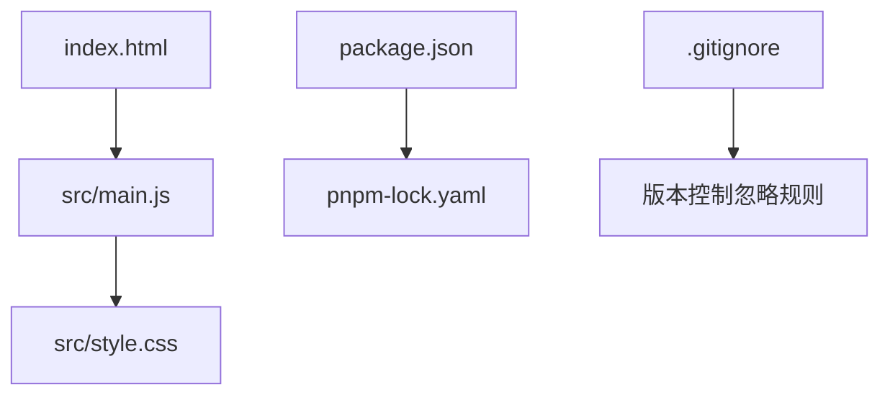
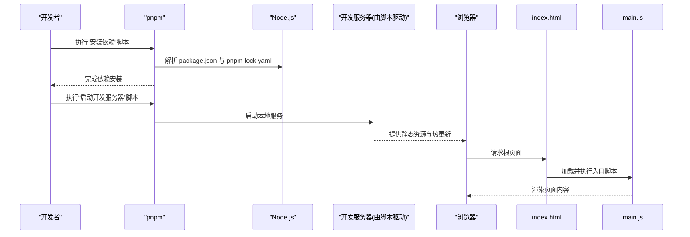
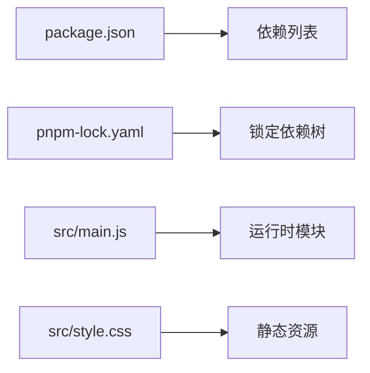

# 快速开始

<cite>
**本文引用的文件**   
- [package.json](file://package.json)
- [pnpm-lock.yaml](file://pnpm-lock.yaml)
- [index.html](file://index.html)
- [src/main.js](file://src/main.js)
- [src/style.css](file://src/style.css)
- [.gitignore](file://.gitignore)
- [README.md](file://README.md)
</cite>

## 目录
1. [简介](#简介)
2. [项目结构](#项目结构)
3. [核心组件](#核心组件)
4. [架构总览](#架构总览)
5. [详细组件分析](#详细组件分析)
6. [依赖分析](#依赖分析)
7. [性能注意事项](#性能注意事项)
8. [故障排除指南](#故障排除指南)
9. [结论](#结论)
10. [附录](#附录)

## 简介
本指南面向从零开始的新用户，帮助你快速搭建并运行 ol-week1 项目的本地开发环境。你将了解：
- 环境要求（Node.js、pnpm）
- 完整安装步骤与开发服务器启动流程
- 项目初始化、依赖安装、本地开发环境搭建的具体命令和配置
- 基本开发工作流（运行项目、查看页面效果、修改代码）
- 常见环境问题的解决方案

## 项目结构
ol-week1 是一个基于现代前端工具链的轻量项目，采用 pnpm 作为包管理器，入口为 index.html，应用逻辑从 src/main.js 启动，样式位于 src/style.css。

图表来源
- [index.html:1-200](file://index.html#L1-L200)
- [src/main.js:1-200](file://src/main.js#L1-L200)
- [src/style.css:1-200](file://src/style.css#L1-L200)
- [package.json:1-200](file://package.json#L1-L200)
- [pnpm-lock.yaml:1-200](file://pnpm-lock.yaml#L1-L200)
- [.gitignore:1-200](file://.gitignore#L1-L200)

章节来源
- [index.html:1-200](file://index.html#L1-L200)
- [src/main.js:1-200](file://src/main.js#L1-L200)
- [src/style.css:1-200](file://src/style.css#L1-L200)
- [package.json:1-200](file://package.json#L1-L200)
- [pnpm-lock.yaml:1-200](file://pnpm-lock.yaml#L1-L200)
- [.gitignore:1-200](file://.gitignore#L1-L200)

## 核心组件
- 入口脚本：src/main.js，负责初始化应用逻辑与挂载到页面。
- 样式文件：src/style.css，提供全局样式。
- 包管理：package.json 定义脚本与依赖；pnpm-lock.yaml 锁定依赖版本。
- 页面模板：index.html 作为浏览器加载的根页面。

章节来源
- [src/main.js:1-200](file://src/main.js#L1-L200)
- [src/style.css:1-200](file://src/style.css#L1-L200)
- [package.json:1-200](file://package.json#L1-L200)
- [pnpm-lock.yaml:1-200](file://pnpm-lock.yaml#L1-L200)
- [index.html:1-200](file://index.html#L1-L200)

## 架构总览
下图展示了从浏览器加载 index.html 到执行 main.js 的基本流程，以及 pnpm 在依赖管理与脚本执行中的作用。

图表来源
- [package.json:1-200](file://package.json#L1-L200)
- [pnpm-lock.yaml:1-200](file://pnpm-lock.yaml#L1-L200)
- [index.html:1-200](file://index.html#L1-L200)
- [src/main.js:1-200](file://src/main.js#L1-L200)

## 详细组件分析

### 环境与前置条件
- 操作系统：Windows、macOS、Linux 均可。
- Node.js：建议使用长期支持版本（LTS）。若未安装，请先安装 Node.js。
- pnpm：推荐使用 pnpm 作为包管理器。可通过 npm 或官方安装器安装。

说明
- 本项目使用 pnpm 进行依赖管理与脚本执行，确保团队一致性与安装速度。
- 若已安装 Node.js，可在终端中通过 node -v 与 pnpm -v 验证版本。

章节来源
- [package.json:1-200](file://package.json#L1-L200)
- [pnpm-lock.yaml:1-200](file://pnpm-lock.yaml#L1-L200)

### 安装与初始化
- 打开终端，进入项目根目录。
- 安装依赖：执行 pnpm install。该命令会读取 package.json 与 pnpm-lock.yaml，生成 node_modules 并缓存依赖。
- 可选：首次克隆后无需额外初始化，pnpm install 即可完成环境准备。

提示
- 若网络受限，可配置国内镜像源或使用代理。
- 如遇权限问题（Linux/macOS），请使用 sudo 或调整目录权限。

章节来源
- [package.json:1-200](file://package.json#L1-L200)
- [pnpm-lock.yaml:1-200](file://pnpm-lock.yaml#L1-L200)

### 启动开发服务器
- 安装完成后，执行 pnpm dev（或 package.json 中定义的启动脚本）。
- 终端将输出本地访问地址（通常为 http://localhost:5173 或类似端口）。
- 在浏览器中打开该地址即可看到页面效果。

注意
- 若端口被占用，请停止占用进程或修改脚本中的端口配置。
- 开发服务器支持热更新，保存文件后浏览器会自动刷新。

章节来源
- [package.json:1-200](file://package.json#L1-L200)
- [index.html:1-200](file://index.html#L1-L200)
- [src/main.js:1-200](file://src/main.js#L1-L200)

### 基本开发工作流
- 修改代码：编辑 src/main.js 或 src/style.css。
- 实时预览：保存后浏览器自动刷新，查看变更效果。
- 调试：在浏览器开发者工具中查看控制台输出与网络请求。
- 提交：使用 .gitignore 忽略构建产物与依赖目录，仅提交源码。

章节来源
- [src/main.js:1-200](file://src/main.js#L1-L200)
- [src/style.css:1-200](file://src/style.css#L1-L200)
- [.gitignore:1-200](file://.gitignore#L1-L200)

### 构建与发布（可选）
- 构建生产版本：执行 pnpm build（以 package.json 中定义的脚本为准）。
- 产物位置：通常位于 dist 或 build 目录（具体取决于脚本配置）。
- 部署：将构建产物上传至静态托管服务或服务器。

章节来源
- [package.json:1-200](file://package.json#L1-L200)

## 依赖分析
- package.json：声明项目依赖与脚本命令。
- pnpm-lock.yaml：锁定依赖树，保证跨环境一致性。
- 运行时依赖：浏览器端主要依赖由入口脚本引入。
- 开发依赖：用于构建与开发服务器（如 Vite 等，具体以 package.json 为准）。

图表来源
- [package.json:1-200](file://package.json#L1-L200)
- [pnpm-lock.yaml:1-200](file://pnpm-lock.yaml#L1-L200)
- [src/main.js:1-200](file://src/main.js#L1-L200)
- [src/style.css:1-200](file://src/style.css#L1-L200)

章节来源
- [package.json:1-200](file://package.json#L1-L200)
- [pnpm-lock.yaml:1-200](file://pnpm-lock.yaml#L1-L200)

## 性能注意事项
- 使用 pnpm 提升安装速度与磁盘占用效率。
- 避免在开发时引入不必要的重型依赖。
- 按需拆分模块，减少首屏加载体积。
- 利用浏览器缓存与 HTTP/2 提升加载性能。

[本节为通用指导，不直接分析具体文件]

## 故障排除指南
常见问题与解决思路：
- 无法找到 pnpm 命令
  - 确认已安装 pnpm 且 PATH 包含其路径。
  - 使用 npx pnpm 临时调用。
- 端口被占用
  - 停止占用进程或修改启动脚本中的端口。
- 依赖安装失败
  - 检查网络连接与镜像源配置。
  - 清理缓存后重试：删除 node_modules 与 pnpm-lock.yaml 后重新安装。
- 浏览器无法访问
  - 确认开发服务器已启动并监听正确端口。
  - 检查防火墙与安全软件拦截。
- Node.js 版本不兼容
  - 升级至 LTS 版本，或在项目中指定引擎版本。

章节来源
- [package.json:1-200](file://package.json#L1-L200)
- [pnpm-lock.yaml:1-200](file://pnpm-lock.yaml#L1-L200)

## 结论
通过以上步骤，你已完成 ol-week1 的环境搭建与本地开发环境配置。建议在日常开发中遵循“修改—保存—预览”的工作流，并结合浏览器开发者工具进行调试。遇到问题时，优先检查 Node.js/pnpm 版本、端口占用与依赖完整性。

[本节为总结性内容，不直接分析具体文件]

## 附录
- README.md：项目说明与补充信息，建议阅读以获取更多上下文。
- .gitignore：版本控制忽略规则，避免提交无关文件。

章节来源
- [README.md:1-200](file://README.md#L1-L200)
- [.gitignore:1-200](file://.gitignore#L1-L200)