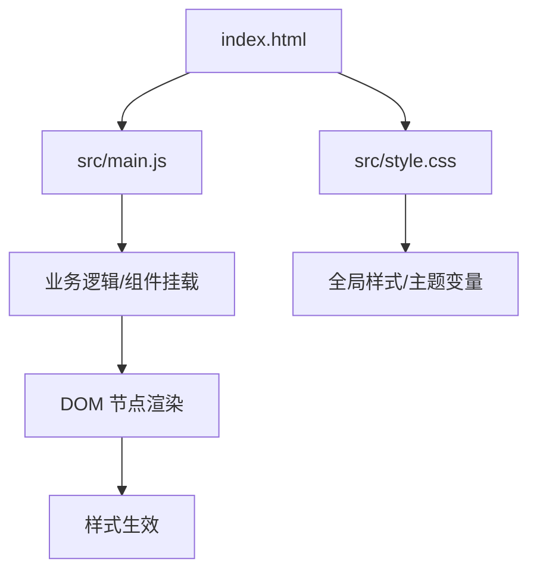
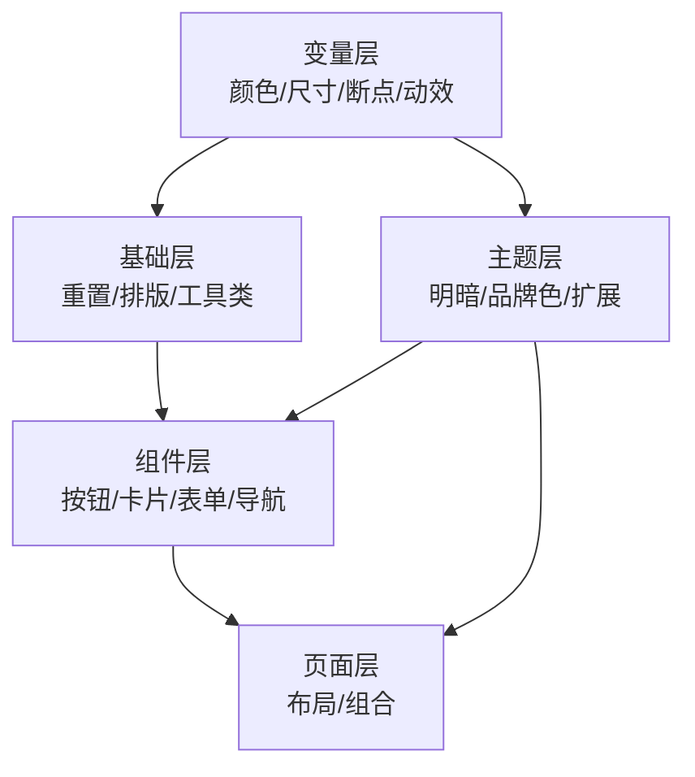
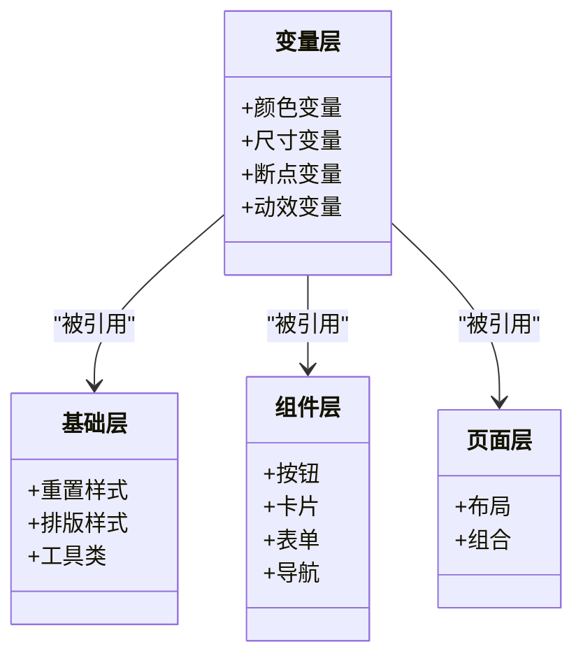
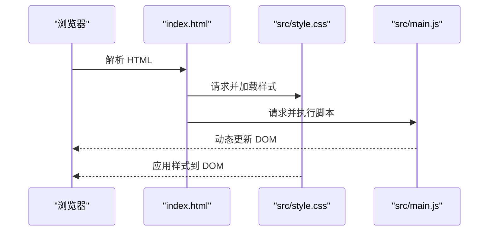
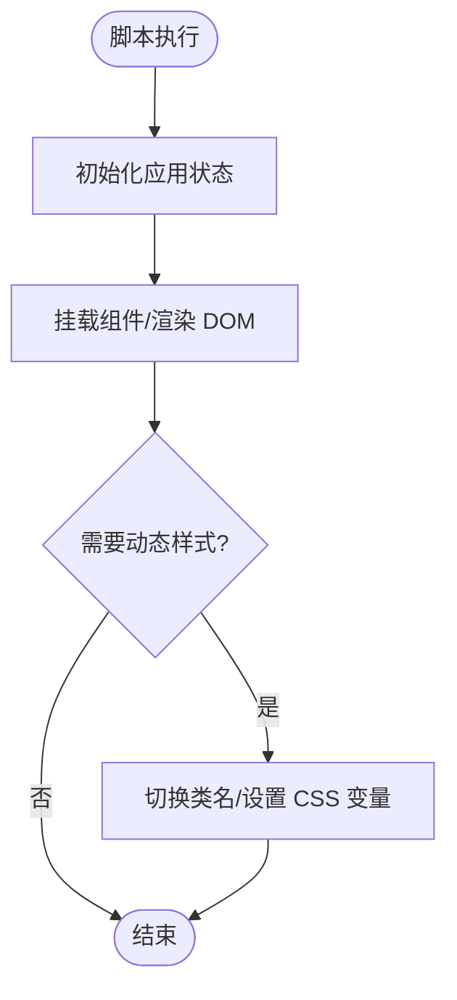
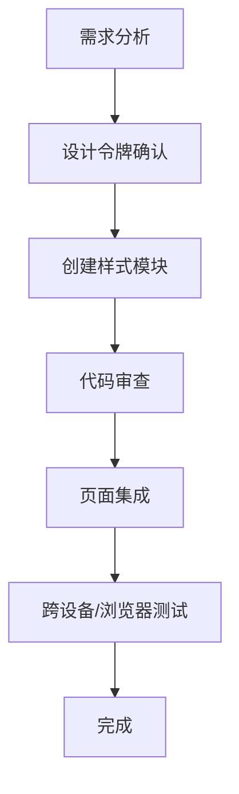
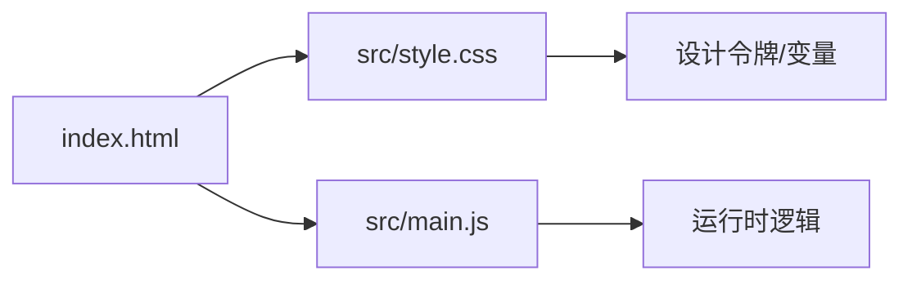

# 样式系统

<cite>
**本文引用的文件**   
- [index.html](file://index.html)
- [src/style.css](file://src/style.css)
- [src/main.js](file://src/main.js)
- [package.json](file://package.json)
- [README.md](file://README.md)
</cite>

## 目录
1. [简介](#简介)
2. [项目结构](#项目结构)
3. [核心组件](#核心组件)
4. [架构总览](#架构总览)
5. [详细组件分析](#详细组件分析)
6. [依赖分析](#依赖分析)
7. [性能考虑](#性能考虑)
8. [故障排查指南](#故障排查指南)
9. [结论](#结论)
10. [附录](#附录)

## 简介
本文件为 ol-week1 项目的样式系统文档，目标是帮助设计师与开发者建立统一的视觉规范、可维护的样式组织方式以及可扩展的主题定制能力。内容涵盖：
- CSS 架构设计与样式组织方式
- 全局样式定义与主题变量
- 响应式布局实现策略
- 跨浏览器兼容性处理
- 样式编写规范、类命名约定与复用策略
- 新增样式组件、修改主题颜色与自定义 UI 元素的方法
- CSS 最佳实践、性能优化技巧与调试方法

## 项目结构
当前仓库采用最小化前端结构，样式入口位于 src/style.css，页面入口为 index.html，应用初始化脚本在 src/main.js。assets 目录预留用于存放图片、字体等静态资源。

**图示来源** 
- [index.html:1-200](file://index.html#L1-L200)
- [src/style.css:1-200](file://src/style.css#L1-L200)
- [src/main.js:1-200](file://src/main.js#L1-L200)

**章节来源**
- [index.html:1-200](file://index.html#L1-L200)
- [src/style.css:1-200](file://src/style.css#L1-L200)
- [src/main.js:1-200](file://src/main.js#L1-L200)

## 核心组件
- 全局样式层（src/style.css）
  - 负责基础重置、排版、间距、颜色、阴影、圆角等设计令牌
  - 提供主题变量（如颜色、字号、行高、断点）以便统一替换
- 页面骨架（index.html）
  - 引入样式与脚本，承载 DOM 结构与语义化标签
- 应用初始化（src/main.js）
  - 负责运行时交互与组件挂载，避免在此处直接写入样式

**章节来源**
- [src/style.css:1-200](file://src/style.css#L1-L200)
- [index.html:1-200](file://index.html#L1-L200)
- [src/main.js:1-200](file://src/main.js#L1-L200)

## 架构总览
样式系统遵循“变量驱动 + 分层组织”的原则：
- 变量层：集中定义颜色、尺寸、断点、动效时长等设计令牌
- 基础层：重置、排版、通用工具类（间距、对齐、隐藏等）
- 组件层：按钮、卡片、表单、导航等可复用 UI 块
- 页面层：页面级布局与组合样式
- 主题层：通过变量切换主题色、明暗模式等

[此图为概念性示意，不直接映射具体文件]

## 详细组件分析

### 全局样式与主题变量（src/style.css）
- 建议将设计令牌集中在一个区域（如 :root 或独立模块），便于主题切换与维护
- 使用语义化变量名（如 --color-primary、--spacing-md、--radius-sm）
- 提供默认值与主题覆盖规则，确保在不同主题下表现一致

**图示来源** 
- [src/style.css:1-200](file://src/style.css#L1-L200)

**章节来源**
- [src/style.css:1-200](file://src/style.css#L1-L200)

### 页面骨架与样式注入（index.html）
- 在 <head> 中引入样式表，确保样式优先加载
- 保持 HTML 语义化，减少内联样式
- 按需引入第三方样式库（如有）

**图示来源** 
- [index.html:1-200](file://index.html#L1-L200)
- [src/style.css:1-200](file://src/style.css#L1-L200)
- [src/main.js:1-200](file://src/main.js#L1-L200)

**章节来源**
- [index.html:1-200](file://index.html#L1-L200)

### 应用初始化与样式职责边界（src/main.js）
- 仅处理运行时逻辑与组件挂载，避免直接操作样式字符串
- 如需动态样式，优先通过切换类名或设置 CSS 变量实现
- 与样式文件解耦，提升可测试性与可维护性

**图示来源** 
- [src/main.js:1-200](file://src/main.js#L1-L200)
- [src/style.css:1-200](file://src/style.css#L1-L200)

**章节来源**
- [src/main.js:1-200](file://src/main.js#L1-L200)

### 新增样式组件流程
- 确定组件范围与变量依赖
- 在组件层创建独立样式模块（或类集合）
- 使用语义化类名，避免与全局冲突
- 在页面层组合使用，必要时提供变体类

[此图为概念性示意，不直接映射具体文件]

## 依赖分析
- 样式依赖关系
  - 页面（index.html）依赖样式（src/style.css）与脚本（src/main.js）
  - 脚本（src/main.js）负责运行时行为，不应直接耦合样式细节
- 构建与包管理
  - package.json 记录依赖与脚本命令，便于统一构建与发布

**图示来源** 
- [index.html:1-200](file://index.html#L1-L200)
- [src/style.css:1-200](file://src/style.css#L1-L200)
- [src/main.js:1-200](file://src/main.js#L1-L200)
- [package.json:1-200](file://package.json#L1-L200)

**章节来源**
- [package.json:1-200](file://package.json#L1-L200)

## 性能考虑
- 样式体积与加载
  - 合并与压缩样式文件，移除未使用规则
  - 按需加载第三方样式，避免一次性引入全部库
- 渲染性能
  - 减少重排与重绘，避免频繁修改布局属性
  - 使用 transform 与 opacity 做动画，利用 GPU 加速
- 选择器性能
  - 避免深层嵌套与复杂选择器，优先使用类选择器
  - 合理使用 CSS 变量，减少重复计算
- 缓存策略
  - 对静态资源启用强缓存与版本化文件名
  - 合理设置 HTTP 缓存头

[本节为通用指导，不直接分析具体文件]

## 故障排查指南
- 样式未生效
  - 检查样式是否被正确引入与加载
  - 确认选择器优先级与覆盖顺序
  - 使用浏览器开发者工具查看最终计算样式
- 主题切换异常
  - 验证 CSS 变量是否正确定义与覆盖
  - 检查动态切换逻辑是否准确设置变量或类名
- 响应式问题
  - 核对媒体查询断点与设备适配
  - 检查容器宽度与弹性布局约束
- 兼容性问题
  - 针对目标浏览器进行特性检测与降级处理
  - 使用 polyfill 或替代方案解决不支持的特性

**章节来源**
- [src/style.css:1-200](file://src/style.css#L1-L200)
- [src/main.js:1-200](file://src/main.js#L1-L200)

## 结论
通过变量驱动的分层样式架构，ol-week1 项目实现了清晰的样式组织与可扩展的主题定制能力。配合规范的类命名、合理的复用策略与完善的调试流程，能够保障视觉一致性与长期可维护性。建议在后续迭代中持续完善组件库与文档，确保团队开发效率与质量。

[本节为总结性内容，不直接分析具体文件]

## 附录

### 样式编写规范
- 类命名
  - 使用语义化、可读性强的名称（如 btn-primary、card-body）
  - 避免缩写与无意义前缀，保持团队一致性
- 组织结构
  - 按变量、基础、组件、页面分层组织
  - 每个组件独立模块，便于复用与维护
- 复用策略
  - 优先使用变量与设计令牌
  - 通过组合类名实现变体，避免重复样式

### 主题定制方法
- 定义主题变量（颜色、尺寸、断点、动效）
- 提供默认主题与覆盖规则
- 通过切换类名或设置 CSS 变量实现动态主题

### 响应式布局实现
- 使用弹性布局与网格布局
- 基于断点的媒体查询适配不同屏幕
- 注意移动端触摸与交互体验

### 跨浏览器兼容性处理
- 特性检测与降级策略
- 使用标准化属性与厂商前缀
- 定期在目标浏览器进行测试

### 性能优化技巧
- 合并与压缩样式
- 避免复杂选择器与深层嵌套
- 合理使用动画与过渡

### 调试方法
- 使用浏览器开发者工具检查样式与布局
- 逐步缩小问题范围，定位冲突与覆盖
- 记录常见问题与解决方案，形成知识库

[本节为通用指导，不直接分析具体文件]