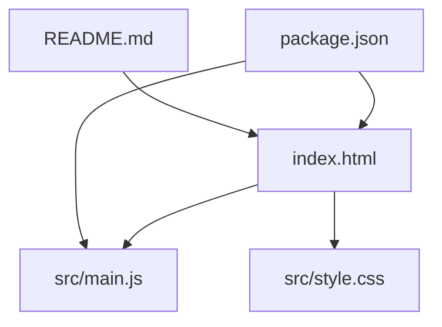
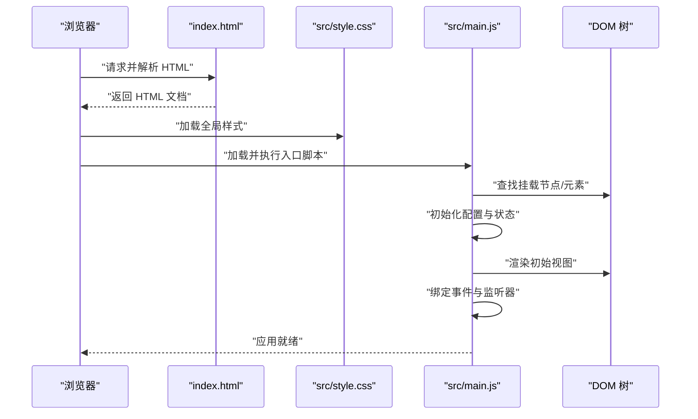
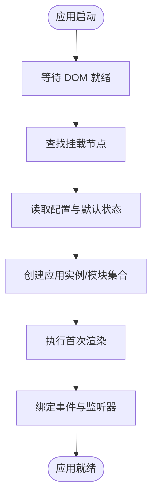
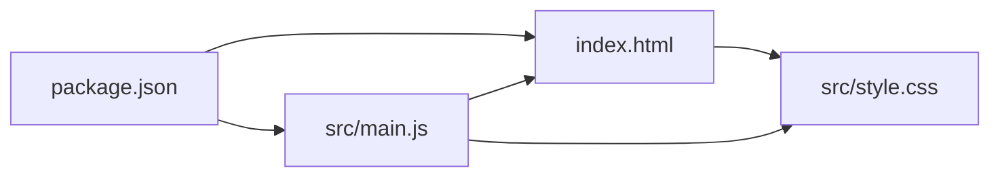

# 核心架构

<cite>
**本文引用的文件**   
- [index.html](file://index.html)
- [src/main.js](file://src/main.js)
- [src/style.css](file://src/style.css)
- [package.json](file://package.json)
- [README.md](file://README.md)
</cite>

## 目录
1. [简介](#简介)
2. [项目结构](#项目结构)
3. [核心组件](#核心组件)
4. [架构总览](#架构总览)
5. [详细组件分析](#详细组件分析)
6. [依赖分析](#依赖分析)
7. [性能考虑](#性能考虑)
8. [故障排查指南](#故障排查指南)
9. [结论](#结论)
10. [附录](#附录)

## 简介
本文件为 ol-week1 项目的核心架构文档，聚焦应用的初始化流程、模块加载机制与组件组织结构。重点说明入口文件 index.html 如何引导应用启动，src/main.js 作为 JavaScript 应用入口的职责与实现方式，以及 src/style.css 全局样式系统的组织与设计。同时阐述 HTML 模板与 JavaScript 应用的集成模式、模块化开发理念与组件化设计思想，并梳理数据流向、事件处理机制与状态管理方案。文末提供架构图表、扩展点识别与最佳实践建议，帮助开发者建立系统级理解。

## 项目结构
项目采用最小化的前端工程结构：
- index.html 作为页面模板与应用挂载点
- src/main.js 作为应用主入口，负责初始化逻辑与模块装配
- src/style.css 作为全局样式定义与主题基础
- package.json 管理依赖与脚本命令
- README.md 提供项目说明与使用说明

图表来源
- [index.html:1-200](file://index.html#L1-L200)
- [src/main.js:1-200](file://src/main.js#L1-L200)
- [src/style.css:1-200](file://src/style.css#L1-L200)
- [package.json:1-200](file://package.json#L1-L200)
- [README.md:1-200](file://README.md#L1-L200)

章节来源
- [index.html:1-200](file://index.html#L1-L200)
- [src/main.js:1-200](file://src/main.js#L1-L200)
- [src/style.css:1-200](file://src/style.css#L1-L200)
- [package.json:1-200](file://package.json#L1-L200)
- [README.md:1-200](file://README.md#L1-L200)

## 核心组件
- 应用入口（index.html）
  - 作用：定义页面骨架、引入样式与脚本、提供应用挂载容器
  - 关键点：确保 DOM 就绪后再执行脚本；通过 id/class 暴露挂载点给 JS 使用
- JavaScript 入口（src/main.js）
  - 作用：初始化应用、注册事件、渲染 UI、管理状态与生命周期
  - 关键点：遵循单一职责，按功能划分模块；避免在入口中堆砌业务逻辑
- 全局样式（src/style.css）
  - 作用：定义 CSS 变量、重置样式、布局基线、主题色与通用组件样式
  - 关键点：命名空间隔离、可复用类、响应式断点集中管理

章节来源
- [index.html:1-200](file://index.html#L1-L200)
- [src/main.js:1-200](file://src/main.js#L1-L200)
- [src/style.css:1-200](file://src/style.css#L1-L200)

## 架构总览
整体架构遵循“模板驱动 + 脚本装配”的轻量模式：HTML 提供结构与挂载点，CSS 统一视觉规范，JS 负责交互与状态。应用启动时由浏览器解析 HTML，随后加载样式与脚本，main.js 完成初始化与渲染。

图表来源
- [index.html:1-200](file://index.html#L1-L200)
- [src/main.js:1-200](file://src/main.js#L1-L200)
- [src/style.css:1-200](file://src/style.css#L1-L200)

## 详细组件分析

### HTML 模板与 JS 应用集成模式
- 集成要点
  - 在 HTML 中预留挂载容器（如根节点），供 main.js 进行首次渲染
  - 通过 script 标签顺序控制加载时序，确保 DOM 可用后再执行脚本
  - 将静态资源路径与运行时配置集中在 HTML 或环境变量中，便于维护
- 推荐做法
  - 使用语义化标签提升可访问性
  - 避免在 HTML 中嵌入过多逻辑，保持结构与行为分离
  - 对关键节点添加 data-* 属性，便于 JS 定位与测试

章节来源
- [index.html:1-200](file://index.html#L1-L200)

### JavaScript 入口与初始化流程
- 初始化步骤
  - 等待 DOM 就绪后获取挂载节点
  - 读取配置与默认状态
  - 创建应用实例或模块集合
  - 执行首次渲染
  - 绑定全局事件与路由（如有）
- 模块化策略
  - 将功能拆分为独立模块（如状态、视图、事件、工具）
  - 通过入口统一装配，避免循环依赖
  - 对外暴露最小 API，内部实现可替换

图表来源
- [src/main.js:1-200](file://src/main.js#L1-L200)

章节来源
- [src/main.js:1-200](file://src/main.js#L1-L200)

### 全局样式系统与主题架构
- 样式分层
  - 基础层：CSS 变量、重置、排版与颜色体系
  - 布局层：栅格、间距、对齐与响应式断点
  - 组件层：通用 UI 组件样式（按钮、卡片、表单等）
  - 页面层：页面级布局与特殊样式
- 命名与隔离
  - 使用 BEM 或前缀命名避免冲突
  - 通过 CSS 变量集中管理主题色与尺寸
  - 限制全局样式影响范围，优先使用局部样式

章节来源
- [src/style.css:1-200](file://src/style.css#L1-L200)

### 数据流向与状态管理
- 数据流方向
  - 用户输入触发事件
  - 事件处理器更新状态
  - 状态变更驱动视图重渲染
- 状态管理方案
  - 小型应用可采用单例对象或模块级状态
  - 复杂场景引入轻量状态库或自定义发布订阅
- 最佳实践
  - 单向数据流，避免双向绑定带来的副作用
  - 状态变更集中化，便于调试与追踪

章节来源
- [src/main.js:1-200](file://src/main.js#L1-L200)

### 事件处理机制
- 事件委托
  - 在父节点上统一监听，减少内存占用
  - 通过事件目标判断具体操作
- 事件解绑
  - 组件销毁或页面切换时及时移除监听器
- 错误边界
  - 捕获异常并降级显示，保证应用稳定性

章节来源
- [src/main.js:1-200](file://src/main.js#L1-L200)

### 组件化设计理念
- 组件边界
  - 每个组件负责单一职责与独立状态
  - 通过 props/events 进行通信
- 组件层次
  - 基础组件（原子）、业务组件（分子）、页面组件（有机体）
- 可复用性
  - 抽象公共逻辑到工具函数或混合模块
  - 通过插槽或内容分发增强灵活性

章节来源
- [src/main.js:1-200](file://src/main.js#L1-L200)

## 依赖分析
- 外部依赖
  - 通过 package.json 声明运行与构建依赖
  - 按需引入第三方库，避免体积膨胀
- 内部依赖
  - main.js 作为装配中心，依赖样式与模板
  - 各模块间通过明确接口耦合，降低环依赖风险

图表来源
- [package.json:1-200](file://package.json#L1-L200)
- [index.html:1-200](file://index.html#L1-L200)
- [src/main.js:1-200](file://src/main.js#L1-L200)
- [src/style.css:1-200](file://src/style.css#L1-L200)

章节来源
- [package.json:1-200](file://package.json#L1-L200)

## 性能考虑
- 首屏优化
  - 延迟非关键脚本加载
  - 压缩与合并资源（构建阶段）
- 渲染优化
  - 减少重排与重绘
  - 使用虚拟滚动或分页加载大数据集
- 内存管理
  - 及时释放事件监听与定时器
  - 避免闭包持有大对象引用

[本节为通用指导，不直接分析具体文件]

## 故障排查指南
- 常见问题
  - DOM 未就绪导致挂载失败：检查脚本加载顺序与事件绑定时机
  - 样式覆盖冲突：审查选择器优先级与作用域
  - 事件未触发：确认事件委托与目标元素存在性
- 调试技巧
  - 使用控制台日志与断点定位问题
  - 通过网络面板检查资源加载状态
  - 利用浏览器开发者工具的组件树与样式检查

章节来源
- [src/main.js:1-200](file://src/main.js#L1-L200)
- [src/style.css:1-200](file://src/style.css#L1-L200)

## 结论
ol-week1 采用简洁的前端架构，以 HTML 模板为结构基础，CSS 统一样式规范，JS 入口负责初始化与装配。该模式易于上手与扩展，适合快速迭代的小型项目。通过明确的模块边界、单向数据流与事件委托机制，可在保持代码清晰的同时提升可维护性与性能。建议在后续演进中逐步引入更细粒度的组件化与状态管理方案，以支撑更复杂的业务需求。

[本节为总结性内容，不直接分析具体文件]

## 附录
- 扩展点识别
  - 在 main.js 中预留插件注册入口
  - 在样式系统中增加主题切换能力
  - 在模板中预留多语言占位符
- 最佳实践清单
  - 单一职责与高内聚低耦合
  - 配置与代码分离
  - 错误边界与降级策略

[本节为补充信息，不直接分析具体文件]