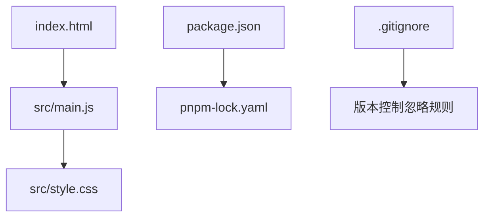
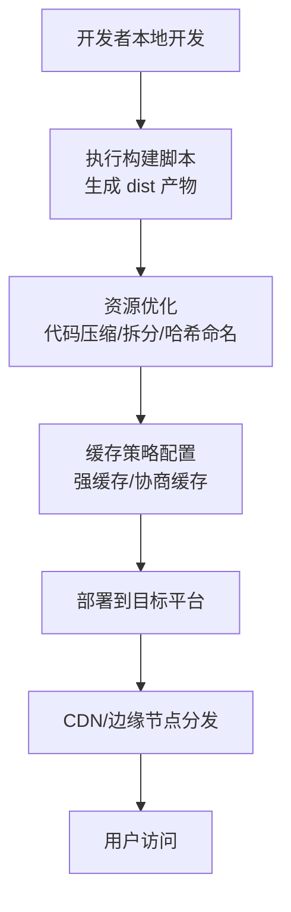
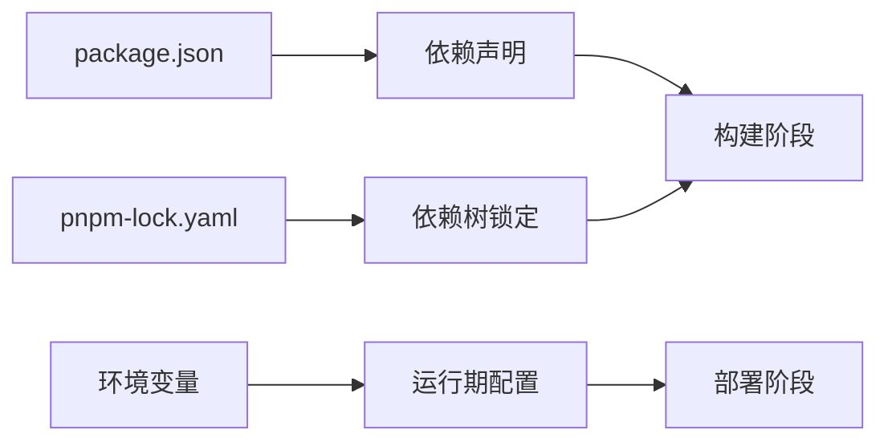

# 部署发布

<cite>
**本文引用的文件**   
- [package.json](file://package.json)
- [pnpm-lock.yaml](file://pnpm-lock.yaml)
- [index.html](file://index.html)
- [src/main.js](file://src/main.js)
- [src/style.css](file://src/style.css)
- [.gitignore](file://.gitignore)
- [README.md](file://README.md)
</cite>

## 目录
1. [简介](#简介)
2. [项目结构](#项目结构)
3. [核心组件](#核心组件)
4. [架构总览](#架构总览)
5. [详细组件分析](#详细组件分析)
6. [依赖分析](#依赖分析)
7. [性能考虑](#性能考虑)
8. [故障排查指南](#故障排查指南)
9. [结论](#结论)
10. [附录](#附录)

## 简介
本指南面向运维与开发者，提供 ol-week1 项目的构建、优化与生产环境部署的完整参考。内容涵盖：
- 构建配置与脚本说明（基于 package.json）
- 生产环境优化策略（代码压缩、资源优化、缓存策略）
- 常见平台的部署步骤（GitHub Pages、Vercel、Netlify）
- 环境变量、域名与 SSL 证书配置
- 版本管理与发布流程

## 项目结构
项目采用典型的前端单页应用结构，入口为 index.html，主逻辑在 src/main.js，样式在 src/style.css。构建与依赖管理通过 package.json 与 pnpm-lock.yaml 维护。

图表来源
- [index.html:1-200](file://index.html#L1-L200)
- [src/main.js:1-200](file://src/main.js#L1-L200)
- [src/style.css:1-200](file://src/style.css#L1-L200)
- [package.json:1-200](file://package.json#L1-L200)
- [pnpm-lock.yaml:1-200](file://pnpm-lock.yaml#L1-L200)
- [.gitignore:1-200](file://.gitignore#L1-L200)

章节来源
- [index.html:1-200](file://index.html#L1-L200)
- [src/main.js:1-200](file://src/main.js#L1-L200)
- [src/style.css:1-200](file://src/style.css#L1-L200)
- [package.json:1-200](file://package.json#L1-L200)
- [pnpm-lock.yaml:1-200](file://pnpm-lock.yaml#L1-L200)
- [.gitignore:1-200](file://.gitignore#L1-L200)

## 核心组件
- 构建脚本与依赖管理：由 package.json 定义，使用 pnpm 进行依赖锁定与安装。
- 应用入口：index.html 引入 main.js，main.js 负责初始化应用并加载样式。
- 静态资源：public 目录用于存放不经过构建器处理的静态资源。

章节来源
- [package.json:1-200](file://package.json#L1-L200)
- [index.html:1-200](file://index.html#L1-L200)
- [src/main.js:1-200](file://src/main.js#L1-L200)
- [src/style.css:1-200](file://src/style.css#L1-L200)

## 架构总览
下图展示从源码到生产产物的构建与部署流程，以及各平台的关键集成点。

[此图为概念性流程图，不直接映射具体源文件]

## 详细组件分析

### 构建脚本与依赖管理（package.json）
- 作用：定义项目元信息、依赖项、脚本命令（如 dev/build/preview），以及可能的构建工具链配置入口。
- 关键要点：
  - scripts：包含开发与构建命令，通常 build 会输出到 dist 目录。
  - dependencies/devDependencies：运行时与开发时依赖分离，确保生产包最小化。
  - pnpm-lock.yaml：锁定依赖版本，保证构建可重复性与一致性。
- 建议：
  - 将构建产物加入 .gitignore，避免提交 dist。
  - 使用 pnpm 安装依赖，保持锁文件一致。

章节来源
- [package.json:1-200](file://package.json#L1-L200)
- [pnpm-lock.yaml:1-200](file://pnpm-lock.yaml#L1-L200)
- [.gitignore:1-200](file://.gitignore#L1-L200)

### 应用入口与资源组织
- index.html：页面骨架，引入 main.js；可在其中配置基础路径或全局变量。
- src/main.js：应用初始化逻辑，挂载根组件、路由、状态管理等。
- src/style.css：全局样式；可按需拆分为模块样式并通过构建工具处理。

章节来源
- [index.html:1-200](file://index.html#L1-L200)
- [src/main.js:1-200](file://src/main.js#L1-L200)
- [src/style.css:1-200](file://src/style.css#L1-L200)

### 环境变量与配置
- 常见方式：
  - 构建期环境变量：通过构建工具注入（如 Vite/webpack），区分开发与生产行为。
  - 运行期环境变量：通过平台提供的环境变量注入（如 Vercel/Netlify/GitHub Actions）。
- 建议：
  - 敏感信息（密钥、API 地址）不要硬编码，统一通过环境变量注入。
  - 不同环境（dev/staging/prod）分别配置，便于隔离与回滚。

章节来源
- [package.json:1-200](file://package.json#L1-L200)
- [README.md:1-200](file://README.md#L1-L200)

### 代码打包与资源优化
- 代码压缩与混淆：启用生产模式压缩 JS/CSS，减小体积。
- 资源拆分与懒加载：按路由或功能模块拆分，按需加载，提升首屏速度。
- 文件名哈希：对静态资源添加内容哈希，利于长期缓存与增量更新。
- 图片与字体优化：使用现代格式（WebP/AVIF）、按需加载字体子集。

章节来源
- [package.json:1-200](file://package.json#L1-L200)
- [src/main.js:1-200](file://src/main.js#L1-L200)
- [src/style.css:1-200](file://src/style.css#L1-L200)

### 缓存策略配置
- 静态资源（JS/CSS/图片/字体）：设置强缓存（Cache-Control: max-age=31536000, immutable），配合文件名哈希实现版本化。
- HTML 文档：短缓存或无缓存（no-cache），确保用户获取最新页面。
- 服务端响应头：合理设置 ETag/Last-Modified，支持协商缓存。

章节来源
- [package.json:1-200](file://package.json#L1-L200)
- [index.html:1-200](file://index.html#L1-L200)

### 常见平台部署步骤

#### GitHub Pages
- 前置条件：仓库中包含构建产物或 CI 构建能力。
- 步骤概览：
  - 在仓库 Settings → Pages 中配置 Source（分支与目录）。
  - 若使用 CI，可通过 Actions 执行构建并部署到 gh-pages 分支。
- 注意事项：
  - SPA 需要配置 history fallback 指向 index.html。
  - 自定义域名需在 DNS 与 Pages 设置中完成绑定。

章节来源
- [package.json:1-200](file://package.json#L1-L200)
- [README.md:1-200](file://README.md#L1-L200)

#### Vercel
- 前置条件：连接 Git 仓库，自动识别框架与构建命令。
- 步骤概览：
  - 导入仓库，选择框架（如 Vite/React/Vue），确认构建与输出目录。
  - 在 Environment Variables 中配置所需变量。
  - 部署后自动生成 HTTPS 与预览链接。
- 注意事项：
  - SPA 路由需开启 Rewrites，将所有请求重定向至 index.html。
  - 自定义域名与 SSL 由平台自动管理。

章节来源
- [package.json:1-200](file://package.json#L1-L200)
- [README.md:1-200](file://README.md#L1-L200)

#### Netlify
- 前置条件：连接 Git 仓库，配置构建命令与发布目录。
- 步骤概览：
  - 在 Site settings → Build & deploy 中设置 Command 与 Publish directory。
  - 在 Environment 中添加环境变量。
  - 部署后启用 HTTPS，并可配置自定义域名。
- 注意事项：
  - SPA 路由需配置 Redirects/Rewrites 指向 index.html。
  - 可使用 Netlify Functions 扩展后端能力。

章节来源
- [package.json:1-200](file://package.json#L1-L200)
- [README.md:1-200](file://README.md#L1-L200)

### 域名设置与 SSL 证书
- 域名解析：将域名 A/CNAME 记录指向平台提供的 IP 或别名。
- 平台绑定：在平台控制台绑定自定义域名，完成验证。
- SSL 证书：
  - 托管平台（Vercel/Netlify）通常自动签发与管理 Let’s Encrypt 证书。
  - 自托管场景需配置反向代理（Nginx/Traefik）并上传证书。
- 强制 HTTPS：在平台或代理层启用 HTTP→HTTPS 跳转。

章节来源
- [README.md:1-200](file://README.md#L1-L200)

### 版本管理与发布流程
- 语义化版本：遵循 major.minor.patch 规范，变更日志清晰记录破坏性更新。
- 标签与发布：
  - 在 Git 打 tag（如 v1.2.3），触发 CI 构建与发布。
  - 平台根据 tag 自动部署对应版本，支持回滚。
- 分支策略：
  - main：稳定版本，仅合并已测试的发布分支。
  - develop：日常开发集成。
  - feature/*：功能分支，完成后合并至 develop。
- 发布检查清单：
  - 构建成功、Lint/测试通过、依赖无高危漏洞、环境变量齐全、缓存策略生效。

章节来源
- [package.json:1-200](file://package.json#L1-L200)
- [pnpm-lock.yaml:1-200](file://pnpm-lock.yaml#L1-L200)
- [README.md:1-200](file://README.md#L1-L200)

## 依赖分析
- 构建与运行时依赖分离：确保生产包不包含开发工具，减少体积。
- 锁文件一致性：使用 pnpm-lock.yaml 锁定依赖树，避免“在我机器上正常”的问题。
- 外部服务依赖：API 地址、第三方 SDK 等通过环境变量注入，便于多环境切换。

图表来源
- [package.json:1-200](file://package.json#L1-L200)
- [pnpm-lock.yaml:1-200](file://pnpm-lock.yaml#L1-L200)

章节来源
- [package.json:1-200](file://package.json#L1-L200)
- [pnpm-lock.yaml:1-200](file://pnpm-lock.yaml#L1-L200)

## 性能考虑
- 首屏优化：
  - 启用代码分割与懒加载，减少初始包大小。
  - 预加载关键资源（字体、首屏图片）。
- 缓存策略：
  - 静态资源长缓存 + 文件名哈希，HTML 短缓存。
- 网络优化：
  - 启用 Gzip/Brotli 压缩。
  - 使用 CDN 加速静态资源分发。
- 监控与度量：
  - 接入性能监控（如 Web Vitals），持续跟踪 LCP/FID/CLS。

[本节为通用指导，不直接分析具体文件]

## 故障排查指南
- 构建失败：
  - 检查 Node/pnpm 版本与锁文件是否匹配。
  - 清理缓存后重试（删除 node_modules 与 pnpm-store）。
- 路由 404：
  - SPA 需配置 history fallback 到 index.html。
- 缓存未更新：
  - 确认文件名哈希是否变化，检查浏览器与服务端缓存头。
- 环境变量未生效：
  - 确认平台环境变量名称与构建期注入变量一致。
- 证书问题：
  - 检查域名解析与平台证书状态，确认 HTTPS 跳转。

章节来源
- [package.json:1-200](file://package.json#L1-L200)
- [README.md:1-200](file://README.md#L1-L200)

## 结论
通过规范的构建脚本、严格的依赖锁定、合理的资源优化与缓存策略，以及标准化的版本与发布流程，ol-week1 可以在主流平台上稳定部署与运行。建议结合平台特性（Vercel/Netlify/GitHub Pages）自动化构建与部署，确保生产环境的一致性与可追溯性。

[本节为总结性内容，不直接分析具体文件]

## 附录
- 快速检查清单：
  - 构建产物位于 dist，且未被提交到版本库。
  - 环境变量齐全且与平台配置一致。
  - 路由重写/转发配置正确（SPA）。
  - 缓存策略生效（静态资源带哈希，HTML 短缓存）。
  - 域名与 SSL 配置无误，强制 HTTPS。
- 常用命令（以 pnpm 为例）：
  - 安装依赖：pnpm install
  - 本地开发：pnpm dev
  - 构建生产包：pnpm build
  - 预览构建结果：pnpm preview

[本节为补充信息，不直接分析具体文件]