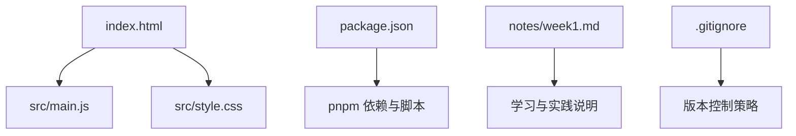
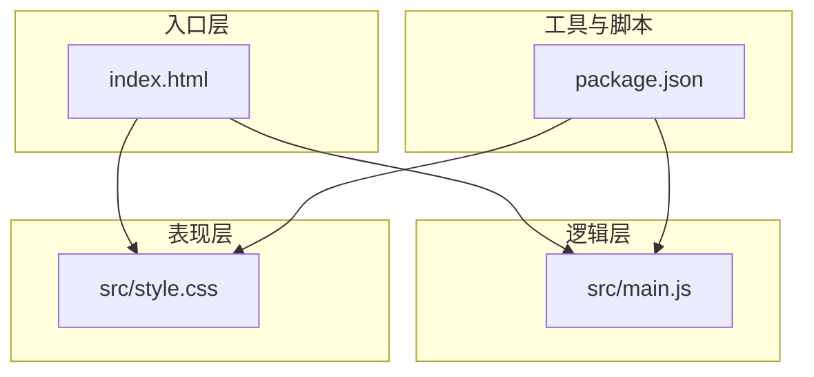
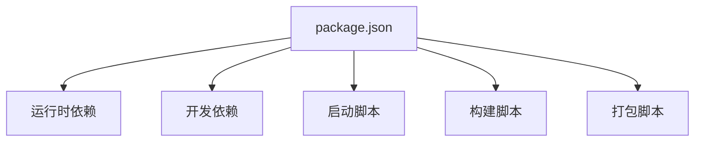

# 项目概述

<cite>
**本文档引用的文件**   
- [README.md](file://README.md)
- [package.json](file://package.json)
- [index.html](file://index.html)
- [src/main.js](file://src/main.js)
- [src/style.css](file://src/style.css)
- [notes/week1.md](file://notes/week1.md)
</cite>

## 目录
1. [简介](#简介)
2. [项目结构](#项目结构)
3. [核心组件](#核心组件)
4. [架构总览](#架构总览)
5. [详细组件分析](#详细组件分析)
6. [依赖分析](#依赖分析)
7. [性能考虑](#性能考虑)
8. [故障排查指南](#故障排查指南)
9. [结论](#结论)
10. [附录](#附录)

## 简介
ol-week1 是一个基于现代前端技术栈的 Web 应用程序，采用模块化架构设计，旨在为初学者提供清晰的项目定位与上手路径，同时为有经验的开发者提供简洁、可扩展的技术概览。项目以 JavaScript、CSS、HTML 为核心语言，使用 pnpm 作为包管理器，强调现代化的用户界面体验、模块化的代码组织、高效的开发流程以及团队协作支持。整体设计理念围绕“简单、可维护、可扩展”展开，便于快速迭代和持续优化。

## 项目结构
项目采用典型的前端工程化目录布局：
- index.html：应用入口页面，承载基础 HTML 结构与资源引用
- src/main.js：应用主逻辑入口，负责初始化与模块装配
- src/style.css：全局样式与主题定义
- notes/week1.md：本周学习与实践记录，辅助理解项目演进思路
- package.json：项目元数据与脚本配置，管理依赖与构建命令
- .gitignore：版本控制忽略规则
- public、.screenshots、assets：静态资源与截图等辅助内容

图表来源
- [index.html:1-20](file://index.html#L1-L20)
- [src/main.js:1-30](file://src/main.js#L1-L30)
- [src/style.css:1-20](file://src/style.css#L1-L20)
- [package.json:1-30](file://package.json#L1-L30)
- [notes/week1.md:1-20](file://notes/week1.md#L1-L20)

章节来源
- [index.html:1-20](file://index.html#L1-L20)
- [package.json:1-30](file://package.json#L1-L30)

## 核心组件
- 入口页面（index.html）：定义应用的基础结构与资源加载顺序，确保样式与脚本正确挂载
- 主逻辑（src/main.js）：负责初始化应用、注册事件与模块装配，体现模块化组织方式
- 样式（src/style.css）：集中管理全局样式与主题变量，保证 UI 一致性与可维护性
- 配置与脚本（package.json）：声明依赖项与开发/构建脚本，统一团队开发环境
- 学习记录（notes/week1.md）：沉淀本周目标、实现要点与经验总结，帮助新成员快速上手

章节来源
- [src/main.js:1-30](file://src/main.js#L1-L30)
- [src/style.css:1-20](file://src/style.css#L1-L20)
- [package.json:1-30](file://package.json#L1-L30)
- [notes/week1.md:1-20](file://notes/week1.md#L1-L20)

## 架构总览
项目遵循“入口页 + 主逻辑 + 样式”的最小可行架构，强调职责分离与模块化：
- 入口层：index.html 仅承担资源引入与容器角色
- 逻辑层：src/main.js 通过模块化方式组织功能，避免全局污染
- 表现层：src/style.css 统一管理视觉规范与响应式适配
- 工具与脚本：package.json 提供统一的依赖管理与脚本执行能力

图表来源
- [index.html:1-20](file://index.html#L1-L20)
- [src/main.js:1-30](file://src/main.js#L1-L30)
- [src/style.css:1-20](file://src/style.css#L1-L20)
- [package.json:1-30](file://package.json#L1-L30)

## 详细组件分析

### 入口页面（index.html）
- 职责：定义文档结构、引入样式与脚本、设置视口与基础元信息
- 设计原则：最小化 HTML 复杂度，保持资源加载顺序可控
- 扩展建议：按需拆分模板片段，提升可复用性

章节来源
- [index.html:1-20](file://index.html#L1-L20)

### 主逻辑（src/main.js）
- 职责：应用初始化、模块装配、事件绑定与状态管理
- 设计原则：模块化组织、单一职责、避免全局变量污染
- 扩展建议：按功能域拆分子模块，引入路由或状态管理库（如需要）

章节来源
- [src/main.js:1-30](file://src/main.js#L1-L30)

### 样式（src/style.css）
- 职责：全局样式、主题变量、响应式布局与组件样式
- 设计原则：命名规范、样式隔离、可维护性强
- 扩展建议：引入 CSS 变量、模块化样式（如 CSS Modules）或预处理器（如 Sass/Less）

章节来源
- [src/style.css:1-20](file://src/style.css#L1-L20)

### 配置与脚本（package.json）
- 职责：声明依赖、定义开发/构建脚本、统一团队环境
- 设计原则：脚本语义化、依赖最小化、版本锁定
- 扩展建议：集成 ESLint、Prettier、自动化测试与 CI/CD

章节来源
- [package.json:1-30](file://package.json#L1-L30)

### 学习记录（notes/week1.md）
- 职责：记录本周目标、实现要点、问题与解决方案
- 设计原则：结构化记录、便于检索与传承
- 扩展建议：增加示例截图、API 参考与最佳实践清单

章节来源
- [notes/week1.md:1-20](file://notes/week1.md#L1-L20)

## 依赖分析
项目依赖由 package.json 统一管理，pnpm 作为包管理器确保安装速度与一致性。主要依赖包括运行时库与开发工具，脚本命令覆盖启动、构建与打包等常见任务。

图表来源
- [package.json:1-30](file://package.json#L1-L30)

章节来源
- [package.json:1-30](file://package.json#L1-L30)

## 性能考虑
- 资源加载：优先加载关键样式与脚本，延迟非关键资源
- 代码分割：按功能模块拆分，减少首屏体积
- 缓存策略：利用浏览器缓存与 CDN 加速静态资源
- 样式优化：合并与压缩 CSS，避免重复定义
- 脚本优化：按需引入库，避免全局污染与冗余计算

[本节为通用指导，不直接分析具体文件]

## 故障排查指南
- 启动失败：检查 package.json 脚本与依赖是否完整，确认 pnpm 环境
- 样式异常：验证 CSS 选择器与作用域，检查浏览器控制台错误
- 脚本错误：查看 main.js 初始化流程，确认 DOM 就绪后再操作元素
- 依赖冲突：清理 node_modules 后重新安装，锁定版本号

章节来源
- [package.json:1-30](file://package.json#L1-L30)
- [src/main.js:1-30](file://src/main.js#L1-L30)
- [src/style.css:1-20](file://src/style.css#L1-L20)

## 结论
ol-week1 以简洁清晰的架构与模块化组织，为前端初学者提供了良好的入门路径，同时为经验丰富的开发者提供了可扩展的技术基线。通过 pnpm 的统一依赖管理与脚本体系，项目具备良好的协作与迭代能力。建议在后续迭代中逐步引入更丰富的工具链与最佳实践，持续提升用户体验与开发效率。

[本节为总结性内容，不直接分析具体文件]

## 附录
- 术语表：pnpm、模块化、入口页、样式隔离
- 推荐扩展：ESLint、Prettier、Vite、Vue/React（按需引入）
- 参考资料：MDN Web 文档、CSS 规范、JavaScript 最佳实践

[本节为补充信息，不直接分析具体文件]