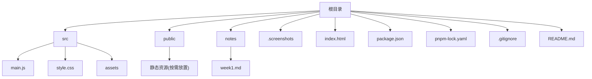
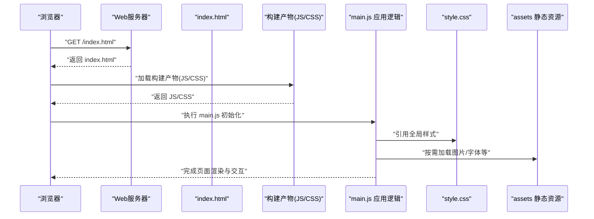
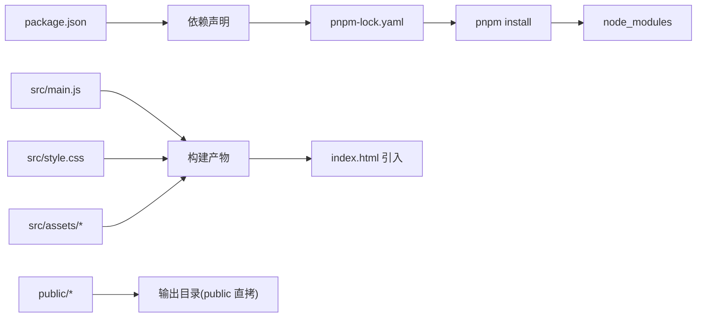

# 项目结构

<cite>
**本文引用的文件**   
- [index.html](file://index.html)
- [package.json](file://package.json)
- [pnpm-lock.yaml](file://pnpm-lock.yaml)
- [.gitignore](file://.gitignore)
- [README.md](file://README.md)
- [src/main.js](file://src/main.js)
- [src/style.css](file://src/style.css)
- [notes/week1.md](file://notes/week1.md)
</cite>

## 目录
1. [简介](#简介)
2. [项目结构总览](#项目结构总览)
3. [核心组件与职责](#核心组件与职责)
4. [架构概览](#架构概览)
5. [详细组件分析](#详细组件分析)
6. [依赖关系分析](#依赖关系分析)
7. [性能考虑](#性能考虑)
8. [故障排查指南](#故障排查指南)
9. [结论](#结论)
10. [附录：命名规范与最佳实践](#附录：命名规范与最佳实践)

## 简介
本文件为 ol-week1 项目的“项目结构”说明文档，面向初学者与后续扩展开发者。内容覆盖目录组织、关键文件职责、构建与依赖配置、HTML 模板结构与开发规范建议，帮助快速理解代码布局并高效开展二次开发。

## 项目结构总览
仓库采用前端常见的前置静态资源与源码分离的组织方式：
- src：源代码与样式入口
- public：构建期不处理的静态资源（如 favicon、robots.txt）
- notes：学习记录与笔记
- .screenshots：截图归档
- 根级配置文件：package.json、pnpm-lock.yaml、.gitignore、index.html、README.md

图表来源
- [index.html](file://index.html)
- [package.json](file://package.json)
- [pnpm-lock.yaml](file://pnpm-lock.yaml)
- [.gitignore](file://.gitignore)
- [README.md](file://README.md)
- [src/main.js](file://src/main.js)
- [src/style.css](file://src/style.css)
- [notes/week1.md](file://notes/week1.md)

章节来源
- [index.html](file://index.html)
- [package.json](file://package.json)
- [pnpm-lock.yaml](file://pnpm-lock.yaml)
- [.gitignore](file://.gitignore)
- [README.md](file://README.md)
- [src/main.js](file://src/main.js)
- [src/style.css](file://src/style.css)
- [notes/week1.md](file://notes/week1.md)

## 核心组件与职责
- index.html：应用入口页面，负责引入构建产物与基础 DOM 骨架。
- src/main.js：应用逻辑入口，挂载业务模块、初始化交互与渲染。
- src/style.css：全局样式与主题变量集中地。
- src/assets：图片、字体、图标等静态资源，供 JS/CSS 引用。
- public：构建时原样拷贝的静态资源，适合放浏览器可直接访问的文件。
- notes/week1.md：本周学习与实现笔记，便于回顾与交接。
- .screenshots：界面截图归档，用于 UI 对比与验收。
- package.json：项目元信息、脚本命令与依赖声明。
- pnpm-lock.yaml：依赖锁定文件，保证团队一致的安装结果。
- .gitignore：版本控制忽略规则，避免提交无关文件。
- README.md：项目说明与使用说明。

章节来源
- [index.html](file://index.html)
- [src/main.js](file://src/main.js)
- [src/style.css](file://src/style.css)
- [notes/week1.md](file://notes/week1.md)
- [package.json](file://package.json)
- [pnpm-lock.yaml](file://pnpm-lock.yaml)
- [.gitignore](file://.gitignore)
- [README.md](file://README.md)

## 架构概览
从加载到渲染的关键路径：浏览器请求 index.html → 解析并加载构建产物（由构建工具生成，通常位于 dist 或 build 输出目录）→ main.js 执行初始化 → 通过 style.css 应用样式 → assets 中的资源按需加载。

图表来源
- [index.html](file://index.html)
- [src/main.js](file://src/main.js)
- [src/style.css](file://src/style.css)

## 详细组件分析

### HTML 模板：index.html
- 作用：定义页面骨架、标题、字符集、视口设置，以及引入构建产物的脚本标签。
- 关键点：
  - 确保正确的 meta 与 viewport 设置以适配移动端。
  - 脚本引入顺序应遵循“先库后应用”的原则（若使用 CDN）。
  - 保持最小化 HTML 结构，将动态内容交由 JS 注入。

章节来源
- [index.html](file://index.html)

### 应用入口：src/main.js
- 作用：应用逻辑的起点，负责初始化框架、注册路由/事件、挂载组件或 DOM 操作。
- 建议：
  - 单一职责：仅做初始化与装配，具体功能下沉到模块文件。
  - 错误边界：对关键初始化过程添加 try/catch 与日志上报。
  - 可测试性：导出必要的初始化函数以便单元测试。

章节来源
- [src/main.js](file://src/main.js)

### 样式入口：src/style.css
- 作用：集中管理全局样式、CSS 变量、重置样式与主题。
- 建议：
  - 使用 CSS 变量管理主题色、字号、间距等。
  - 按模块拆分样式文件并在入口统一导入（当规模增长时）。
  - 避免在组件内写大量内联样式，保持样式可维护性。

章节来源
- [src/style.css](file://src/style.css)

### 静态资源：src/assets
- 作用：存放图片、字体、图标等被 JS/CSS 引用的资源。
- 建议：
  - 按功能或页面维度组织子目录，例如 images、fonts、icons。
  - 使用相对路径引用，便于打包工具处理缓存与压缩。

章节来源
- [src/assets](file://src/assets)

### 公共静态资源：public
- 作用：构建时原样拷贝至输出目录，适合放置 favicon、robots.txt、manifest 等。
- 建议：
  - 仅放置无需构建处理的静态文件。
  - 文件名语义化，避免冲突。

章节来源
- [public](file://public)

### 笔记与截图：notes/.screenshots
- notes/week1.md：记录本周目标、实现思路、踩坑与复盘。
- .screenshots：UI 截图归档，便于前后对比与评审。
- 建议：
  - 笔记结构化（背景、目标、步骤、结果、问题、改进）。
  - 截图命名包含日期与变更点，便于检索。

章节来源
- [notes/week1.md](file://notes/week1.md)

### 项目配置：package.json
- 作用：声明项目名称、版本、脚本命令、依赖与开发依赖。
- 关键点：
  - scripts：定义启动、构建、测试等常用命令。
  - dependencies/devDependencies：区分运行与开发依赖。
  - 包管理器：本项目使用 pnpm，需配合 pnpm 命令。

章节来源
- [package.json](file://package.json)

### 依赖锁定：pnpm-lock.yaml
- 作用：锁定依赖树，确保团队成员安装一致的依赖版本。
- 建议：
  - 提交至版本控制，避免“在我机器上能跑”的问题。
  - 更新依赖时使用 pnpm update 并审查变更。

章节来源
- [pnpm-lock.yaml](file://pnpm-lock.yaml)

### 版本控制忽略：.gitignore
- 作用：排除 node_modules、构建产物、IDE 配置、敏感信息等。
- 建议：
  - 明确列出忽略规则，避免误提交。
  - 定期清理未跟踪文件，保持仓库整洁。

章节来源
- [.gitignore](file://.gitignore)

### 项目说明：README.md
- 作用：项目介绍、环境要求、安装与运行步骤、常见问题。
- 建议：
  - 提供一键安装与启动命令。
  - 补充本地开发与部署注意事项。

章节来源
- [README.md](file://README.md)

## 依赖关系分析
- 运行时依赖：由 package.json 声明，pnpm 安装后写入 pnpm-lock.yaml 锁定版本。
- 构建产物：构建工具根据入口（通常为 src/main.js）生成 JS/CSS，最终被 index.html 引入。
- 静态资源：src/assets 由构建工具处理；public 直接拷贝到输出目录。

图表来源
- [package.json](file://package.json)
- [pnpm-lock.yaml](file://pnpm-lock.yaml)
- [src/main.js](file://src/main.js)
- [src/style.css](file://src/style.css)
- [index.html](file://index.html)

章节来源
- [package.json](file://package.json)
- [pnpm-lock.yaml](file://pnpm-lock.yaml)
- [src/main.js](file://src/main.js)
- [src/style.css](file://src/style.css)
- [index.html](file://index.html)

## 性能考虑
- 资源体积：启用构建工具的代码分割、Tree Shaking 与资源压缩。
- 缓存策略：对静态资源使用长缓存与版本号/哈希命名。
- 首屏优化：延迟加载非关键脚本与图片，预加载关键资源。
- 样式优化：合并与去重样式，避免重复选择器与无用 CSS。

[本节为通用指导，不直接分析具体文件]

## 故障排查指南
- 依赖安装失败：检查网络与镜像源，确认 pnpm 版本与 Node 版本兼容。
- 构建失败：查看控制台报错定位入口或模块引用问题，必要时清理缓存重试。
- 资源 404：核对路径是否正确，确认资源是否被构建工具处理或应从 public 引入。
- 样式不生效：检查 CSS 引入顺序与作用域，避免被覆盖。
- 启动异常：确认端口占用、环境变量与权限。

章节来源
- [package.json](file://package.json)
- [pnpm-lock.yaml](file://pnpm-lock.yaml)
- [src/main.js](file://src/main.js)
- [src/style.css](file://src/style.css)
- [index.html](file://index.html)

## 结论
ol-week1 采用清晰的前端工程化结构：入口 HTML、JS/CSS 入口与静态资源分离，配合 pnpm 进行依赖管理与锁定。遵循本文的结构与规范，有助于提升团队协作效率与代码可维护性。

[本节为总结性内容，不直接分析具体文件]

## 附录：命名规范与最佳实践
- 目录与文件命名
  - 小写英文 + 短横线分隔（kebab-case），如 main.js、style.css。
  - 资源目录按类型划分：images、fonts、icons。
  - 笔记与截图命名包含日期与变更点，如 2024-06-01-homepage.png。
- 代码组织
  - 入口文件只做装配与初始化，业务逻辑模块化拆分。
  - 样式集中管理，按模块拆分并在入口统一导入。
- 依赖管理
  - 使用 pnpm，提交 pnpm-lock.yaml 保证一致性。
  - 区分生产与开发依赖，减少包体积。
- 版本控制
  - .gitignore 明确忽略规则，避免提交无关文件。
  - 提交信息简洁明了，关联需求或问题编号。
- 文档与协作
  - README 提供完整的环境与运行说明。
  - notes 记录关键决策与踩坑经验，便于交接。

[本节为通用指导，不直接分析具体文件]